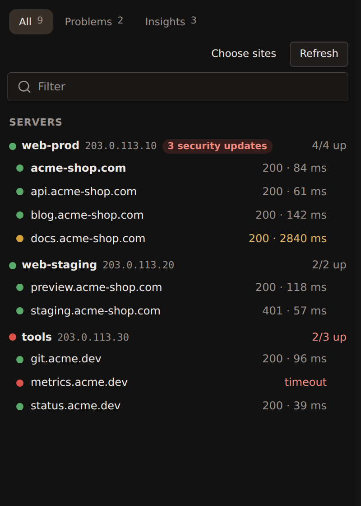
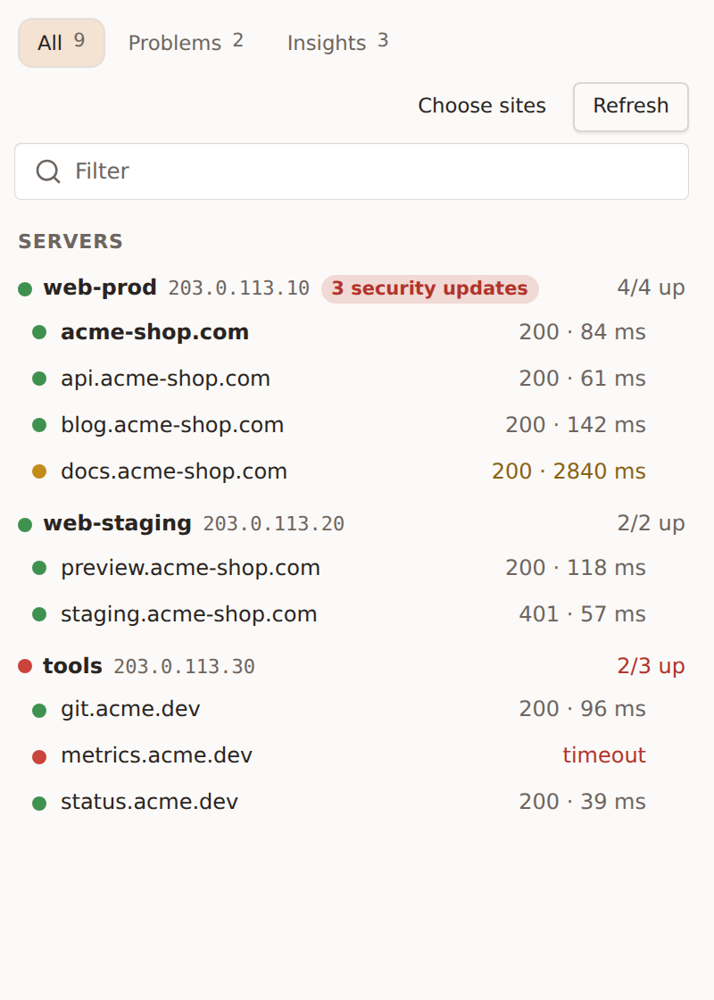
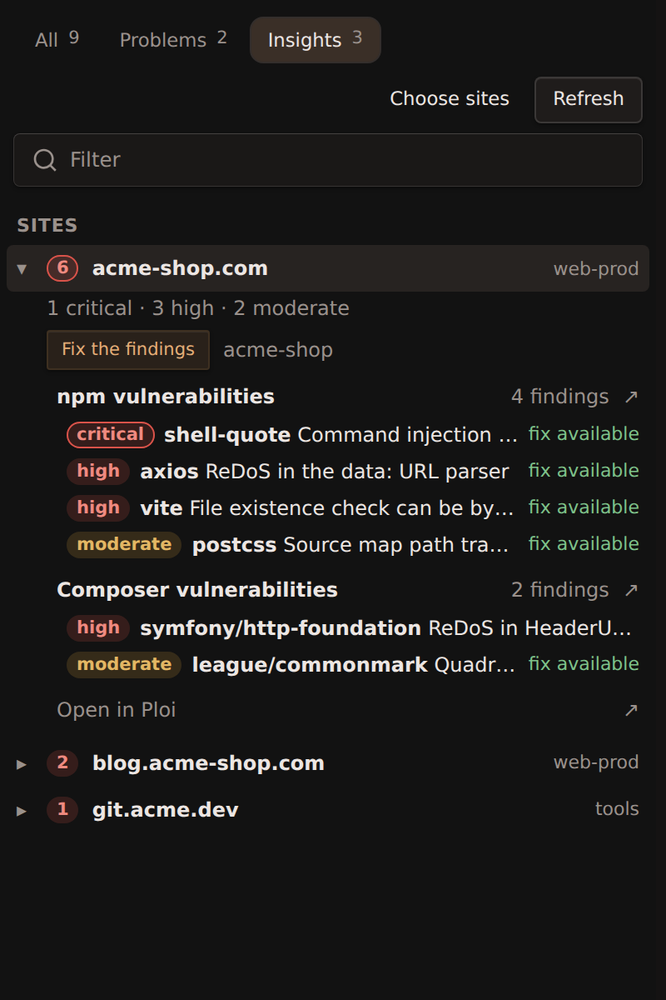
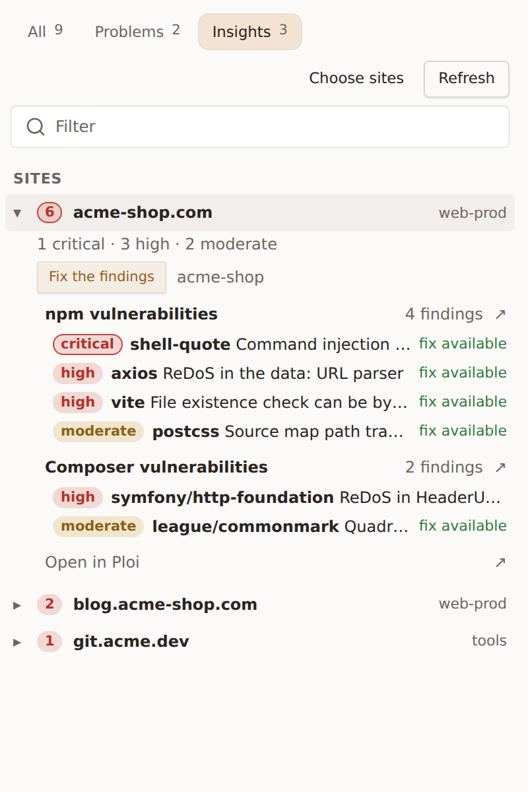
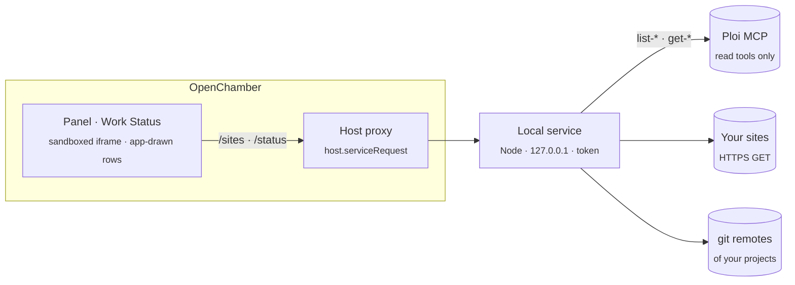

<div align="center">

# Ploi

**Your Ploi servers and sites, checked live, without leaving OpenChamber.**

Every server and site of your [Ploi](https://ploi.io) account in [OpenChamber](https://github.com/openchamber/openchamber): a live HTTP check of each site, Ploi insights split per site, and one click to start an agent session that fixes them.


<br />

<table>
  <tr>
    <td align="center" width="50%"><br /><sub>Side panel, dark theme</sub></td>
    <td align="center" width="50%"><br /><sub>Side panel, light theme</sub></td>
  </tr>
</table>

</div>

---

## Why

Your sites run on servers you rarely open. A deploy breaks a page, a certificate stops renewing, a dependency gets a critical advisory, and you find out late. Ploi shows all of it, but in another tab. This extension puts it **where you already work**: a side panel and a Work Status section that check every site while you code, and agents that know which Ploi site the open project runs on.

## Features

| | |
|---|---|
| 🩺 **Live checks** | Each site is fetched over HTTPS (its Ploi health URL when it has one): HTTP status and response time, slow sites over 2 s in amber, errors and timeouts in red. 401 and 403 count as up, so a staging site behind a password is not a failure. |
| 🖥️ **Servers** | Every server with its IP, sites up out of total, and pending security updates. |
| 🛡️ **Insights per site** | Ploi insights (vulnerable Composer and npm dependencies, failed SSL renewals…) split per site, worst first, each finding with its severity, package, advisory link and whether a fix exists. |
| 🤖 **Fix the findings** | One click starts a session in the local project deployed to that site, with every finding and a brief: smallest updates, run the tests, never deploy. |
| 📌 **This project** | The open project's site is found from its `origin` remote (else its `APP_URL`), shown in bold, and given to agents as `site_id` / `server_id`. |
| 🙈 **Choose sites** | Hide the sites you do not care about. Hidden sites are neither shown nor checked; new sites appear by default. |
| 🔗 **Ploi one click away** | A site or a server opens its page in the Ploi dashboard; ↗ opens the site itself. |
| 🌗 **Theme & language** | Follows OpenChamber's light/dark theme. English and French interface. |
| 🔒 **Read-only by design** | Only Ploi read tools. No deploy, restart, fix or ignore, ever. |

<table>
  <tr>
    <td align="center" width="50%"><br /><sub>Insights tab, dark theme</sub></td>
    <td align="center" width="50%"><br /><sub>Insights tab, light theme</sub></td>
  </tr>
</table>

## Quick start

> [!NOTE]
> Requires OpenChamber **2.7.2** or later, and the **Ploi MCP server configured in OpenCode** (Ploi Pro plan or higher).

1. Add the Ploi MCP server to `~/.config/opencode/opencode.json`, as a remote server named `ploi` (any remote server on `ploi.io` works too):
   ```json
   { "mcp": { "servers": { "ploi": { "type": "remote", "url": "https://ploi.io/api/mcp",
     "headers": { "Authorization": "Bearer {file:~/.config/opencode/secrets/ploi-mcp}" } } } } }
   ```
   `mcp.<name>` (OpenCode 1) and `mcp.servers.<name>` (OpenCode 2) both work, as do `{env:…}` / `{file:…}` placeholders and an OAuth token stored by OpenCode. The extension reuses that credential: there is nothing to configure in OpenChamber.
2. Install the extension: [open in OpenChamber](openchamber://extensions/install?url=https%3A%2F%2Fgithub.com%2FMltStephane%2Fopenchamber-ploi), or paste `https://github.com/MltStephane/openchamber-ploi` in **Settings → Extensions**. From a local clone, paste the folder's absolute path instead:
   ```sh
   git clone https://github.com/MltStephane/openchamber-ploi.git
   ```
3. Update it later by raising `version`: OpenChamber offers the update in **Settings → Extensions**.
4. **Approve** what the extension asks for: the local service (it runs `git` to read your projects' remotes), and *sessions* + *prompt* for *Fix the findings*.
5. Click the <kbd>Ploi</kbd> icon on the rail for the **panel**; the **Ploi** section appears in Work Status.

> [!TIP]
> The built files (`panel/main.js`, `service/main.js`) are committed: OpenChamber compiles nothing. After changing the sources, run `npm run build`, then reload the extension.

## Using it

- **Open in Ploi**: click a site or a server. Hover a site for its repository, last deploy and last check; the ↗ button opens the site.
- **Narrow the list**: *All* / *Problems* (down, error or slow), or type in the filter (domain, repository, server, IP).
- **Hide sites**: *Choose sites*, tick what you want to see, one site or a whole server at a time, then *Done*. *Show all* brings everything back.
- **Read the insights**: open the *Insights* tab and unfold a site. A finding opens its advisory, an insight title opens the server's insights in Ploi.
- **Fix them**: *Fix the findings* on an unfolded site starts a session in the matching project and opens it. A site with no local project says so instead.
- **Work Status**: the open project's site first with a latency chart, then one line per server and the sites in trouble. The *View* select switches to *All sites*.
- **Refresh**: re-reads Ploi and checks every site again. Otherwise the panel reads every minute while it is visible, and the section every 15 s while it is on screen.

## How it works



The panel runs in a sandboxed iframe with no network; the Work Status section is drawn by the app from the service's answer. Both go through a local Node service that OpenChamber starts (`contributes.service`). The service listens on `127.0.0.1`, requires the `OPENCHAMBER_SERVICE_TOKEN` token, finds the Ploi MCP server in the OpenCode config, and talks to it over MCP Streamable HTTP.

- **Ploi**: `list-servers` and `list-sites` every 5 minutes, `get-site-repository` per site every 30 minutes, `list-server-insights` and `get-server-insight` every 15 minutes, all on *Refresh* too.
- **Insights per site**: Ploi files insights per server; each explanation links the sites it concerns, and `src/insights.ts` splits it from those links (tested against real answers in `test/fixtures/`).
- **Checks**: `GET` with redirects followed, 10 s timeout, body never read, each site at most once a minute, 6 at a time, only while the panel or the section is on screen.
- **Projects**: a site's project is the OpenChamber project whose `origin` remote is the site's Ploi repository, else whose `APP_URL` (`.env`, `.env.production`) is the site's domain.
- **Hidden sites** are kept in `~/.config/openchamber-ploi/preferences.json`, the only file the service writes.

### Service API

| Route | Body / query | Response |
|---|---|---|
| `GET /health` | | `{}` |
| `GET /status` | `locale`, `directory` | The Work Status section (`GuestStatusView`) |
| `POST /status` | `{ id: "view", value: "overview" \| "sites" }` or `{ id: "refresh" }` | `{ ok: true }` |
| `GET /sites` | `directory` | The panel's data (`SitesPayload`, `src/sites-contract.ts`) |
| `POST /refresh` | | `{ ok: true }` after Ploi is read and the sites checked again |
| `POST /hidden` | `{ hidden: number[] }` | `{ ok: true, hidden }` |
| `POST /projects` | `{ projects: { id, directory }[] }` | `{ ready, matches: { [siteId]: { projectId, by } } }` |

Failures never come back as a 500 to the section: a missing MCP server, a refused token or an unreachable Ploi is a note saying what to do, an unreachable site is a red dot.

## Limits

- Checks run only while the panel or the section is on screen: this is not an uptime monitor and sends no alert.
- *Fix the findings* works in the project's main folder, not in a separate worktree.
- A site whose Ploi repository was renamed is not matched to a project with the new remote until the repository is updated in Ploi.

## Development

```sh
bun install
npm run build      # panel/main.js (browser IIFE) + service/main.js (Node ESM), via openchamber-guest-bundle (Bun)
npm test           # bun test
npm run typecheck  # tsc --noEmit
bunx openchamber-guest-check
```

The tests cover the OpenCode config lookup, the MCP client, Ploi parsing, project matching, HTTP checks, the insight parser on real Ploi answers, the Work Status rows (validated against the SDK schema), the panel and insights models, the fix prompt, preferences and i18n.

Test the service by hand (it reads the real Ploi account through the MCP configured in OpenCode):

```sh
OPENCHAMBER_SERVICE_PORT=4599 OPENCHAMBER_SERVICE_TOKEN=t node service/main.js &
curl -H 'Authorization: Bearer t' 'http://127.0.0.1:4599/sites?directory=/path/to/project'
```

<details>
<summary><strong>Project layout</strong></summary>

```
package.json                  manifest (openchamber.contributes: panel, service, statusSection, instructions, capabilities)
icon.svg                      rail icon
panel/index.html              page loaded in the iframe
panel/main.js                 IIFE bundle (built)
service/main.js               local service (built)
src/service.ts                local HTTP service: routes, caches, checks, agent instructions
src/opencode-config.ts        finds the Ploi MCP server and its credential in the OpenCode config
src/mcp-client.ts             minimal MCP Streamable HTTP client
src/ploi.ts                   servers, sites, repositories, Ploi dashboard URLs
src/insights.ts               insight list and explanation parser
src/project.ts                git remote and APP_URL of a project, site matching
src/probe.ts                  one HTTP check and its health
src/preferences.ts            hidden sites file
src/status-view.ts            Work Status rows (pure)
src/sites-contract.ts         /sites answer shared by service and panel
src/sites-payload.ts          builds the /sites answer (pure)
src/fix-prompt.ts             first message of a fix session (pure)
src/relative-time.ts          relative dates
src/i18n.ts                   English and French texts
src/panel/main.ts             panel state, site list, choose mode, fix sessions
src/panel/insights-view.ts    Insights tab
src/panel/service-client.ts   service calls, answers checked
src/panel/model.ts            site list model (pure)
src/panel/insights-model.ts   insights per site model (pure)
src/panel/view.ts             styles and DOM helpers
docs/                         icon and README screenshots
test/                         bun tests and real Ploi fixtures
```

</details>
